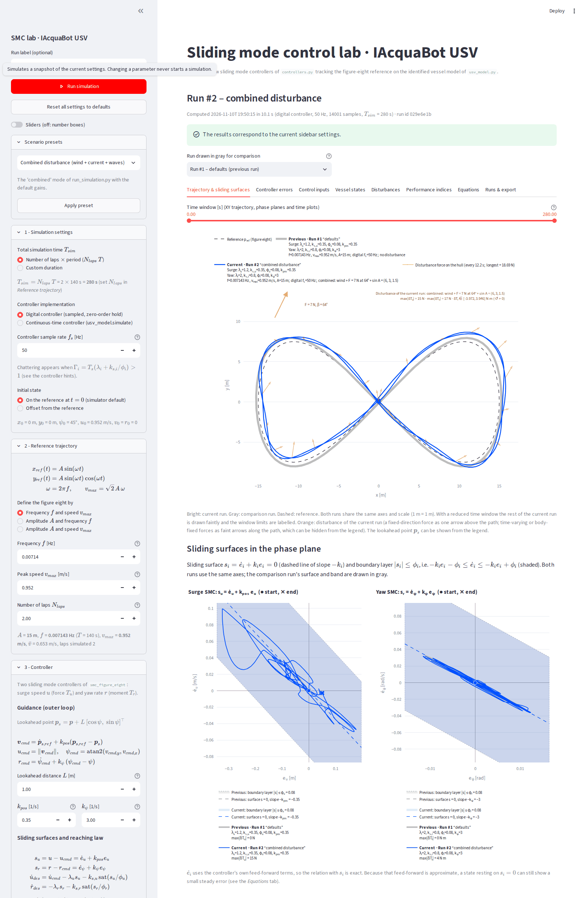
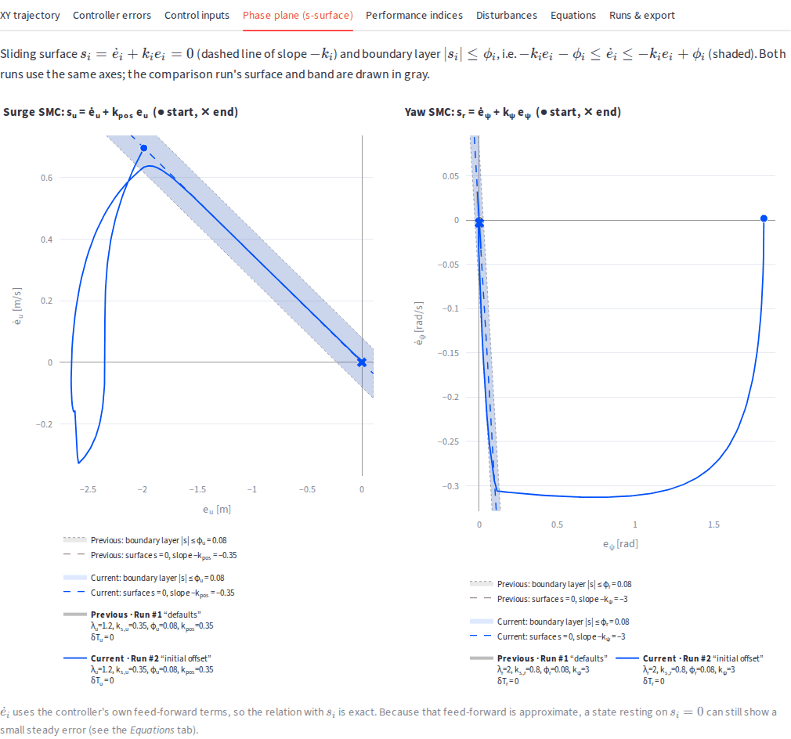
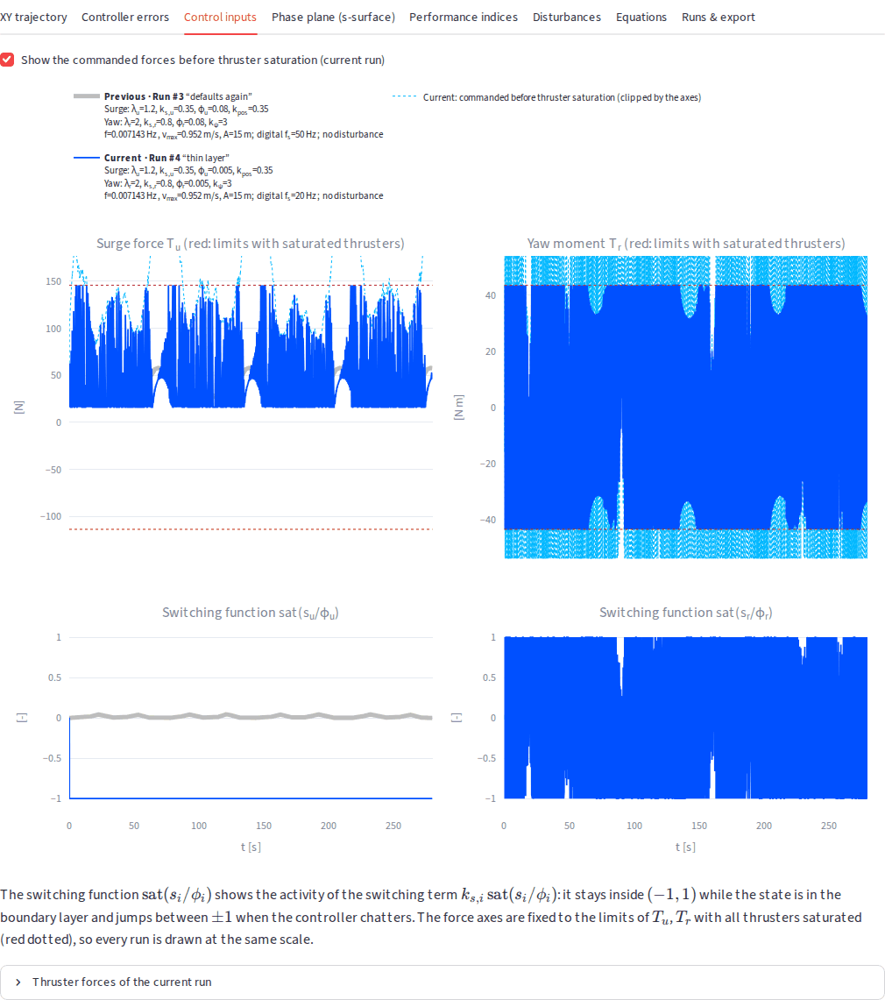
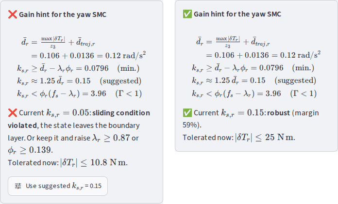
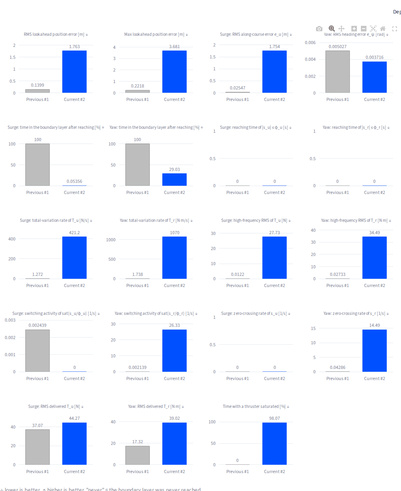

# Sliding mode control lab (`dashboard02_smc`)

Interactive Streamlit dashboard for studying how the **surge** and **yaw sliding
mode controllers** of the IAcquaBot USV behave when their parameters change. The
vessel follows the figure-eight reference of the simulator, and the results of the
current run are drawn in a **bright colour** on top of the **previous run in pale
gray**, on the same axes.

The dashboard drives the existing simulator: the identified model (`usv_model.py`),
the sliding mode controller `smc_figure_eight` (`controllers.py`) and the disturbance
functions (`disturbances.py`). It does not re-implement any dynamics or control law.
Obstacles, CBF filtering and the reference governor are not used.



Installation details are in [Requirements.md](Requirements.md).

---

## 1. Quick start

From the project root (the folder that contains `usv_model.py`):

```powershell
# Windows PowerShell
python -m venv .venv
.\.venv\Scripts\python.exe -m pip install -r dashboard02_smc\requirements.txt
.\.venv\Scripts\python.exe -m dashboard02_smc
```

```bash
# Linux / macOS
python3 -m venv .venv
.venv/bin/python -m pip install -r dashboard02_smc/requirements.txt
.venv/bin/python -m dashboard02_smc
```

The browser opens at <http://localhost:8501>. `streamlit run dashboard02_smc/app.py`
is equivalent. Streamlit options can be appended, e.g.
`python -m dashboard02_smc --server.port 8602`. Stop the server with `Ctrl+C`.

---

## 2. Using the dashboard

1. **Set up the experiment in the sidebar.** It has the same structure as the first
   dashboard (`dashboard/`), and every equation is shown in LaTeX next to its
   parameters:
   1. *1 - Simulation settings*: total time (**laps × period** or a **custom
      duration**), digital or continuous controller (sample rate $f_s$ or output
      interval $\Delta t$), and the initial state (**on the reference** or **offset
      from the reference**).
   2. *2 - Reference trajectory*: the figure eight, defined by **frequency and
      speed** (default), by amplitude and frequency, or by amplitude and speed; plus
      the number of laps.
   3. *3 - Controller*: guidance (outer loop) with $L$ and $k_{pos}$ | $k_\psi$;
      sliding surfaces and reaching law with the surge | yaw pairs
      $\lambda_u$ | $\lambda_r$, $k_{s,u}$ | $k_{s,r}$, $\phi_u$ | $\phi_r$ side by
      side; the model inversion; a one-line **switching-gain check** per SMC and the
      *Design hints*.
   4. *4 - Disturbance*: the six models of `disturbances.py`, with the same
      parameters and defaults as the first dashboard: **none, constant,
      sinusoidal, directional force, wind-like, combined** (wind + directional +
      sinusoidal). Below the parameters: the worst-case bounds and the **gain hints**
      for both SMCs (see [section 4](#4-gain-hints-how-large-must-the-switching-gain-be)).

   Parameters are entered in number boxes (as in the first dashboard); the
   **Sliders** toggle switches all of them to sliders and back without losing the
   values. *Reset all settings to defaults* and the *Scenario presets* fill the
   sidebar without running a simulation.
2. **Press _Run simulation_.** Results are computed only when this button is
   pressed. Changing a parameter never starts a simulation. Invalid settings (e.g.
   $\phi_u = 0$) are listed in red and disable the button. Questionable settings
   (e.g. a reference faster than the thrusters can sustain) are shown as warnings.
3. **Read the results.** The first tab, **Trajectory & sliding surfaces**, is the
   main view: the **time window** slider, the **XY trajectory** (current run in blue
   over the comparison run in gray, with the disturbance drawn subtly in orange,
   see below) and, right under it, the **phase planes with the sliding surfaces**
   of both SMCs. The comparison of the two runs comes **below the plots**: a LaTeX card
   with the parameters of the current run and of the comparison run (parameters that
   differ are shown in orange) and six key indices with their change.
   If you change a parameter after a run, a yellow banner lists the changed settings
   until you run again, so results are never mistaken for the new settings.
4. **Tabs**

   | Tab | Content |
   | --- | --- |
   | Trajectory & sliding surfaces | Time window slider; XY trajectory (reference, current run, comparison run; equal axis scales; disturbance of the current run; window limits); phase planes $\dot e_i$ vs $e_i$ of both SMCs with the sliding surface $s_i = 0$ and the shaded band $\lvert s_i\rvert \le \phi_i$, for both runs. |
   | Controller errors | $\lVert e_p\rVert$; $e_u$, $\dot e_u$, $s_u$ (surge); $e_\psi$, $\dot e_\psi$, $s_r$ (yaw); shaded boundary layers $\lvert s_i\rvert \le \phi_i$. |
   | Control inputs | Delivered $T_u$, $T_r$ (and the commanded values before thruster saturation), the switching functions $\mathrm{sat}(s_i/\phi_i)$, thruster forces. |
   | Vessel states | $u$, $v$, $r$, $\psi$ of both runs, with the commands $u_{cmd}$, $r_{cmd}$, $\psi_{cmd}$ of the current run (dotted). |
   | Disturbances | $\delta T_u$, $\delta T_v$, $\delta T_r$ of both runs. |
   | Performance indices | Bar charts (gray = comparison, bright = current), a table with the change and a better/worse verdict, and the LaTeX definition of every index. |
   | Equations | Model, allocation, reference, outer loop, both SMCs, phase-plane mapping, design hints. |
   | Runs & export | Full configuration, JSON and CSV download, Python snippet to reproduce a run, list of stored runs, *Load its settings into the sidebar*. |

5. **Display controls** do not run simulations:
   * *Run drawn in gray for comparison* (above the tabs): the previous run by
     default, any stored run (last 10), or none.
   * *Time window* (on top of the XY trajectory): restricts the XY trajectory, both
     phase planes and all time plots, e.g. to skip the initial transient. In the XY
     trajectory the rest of the current run stays visible as a faint line and the
     window limits are labelled ($t$ = … s). The other tabs state the active window.
     The indices always use the whole run.
6. **Scenario presets** (sidebar) load typical experiments into the sidebar without
   running them: simulator defaults, reaching phase (initial offset), thin boundary
   layer (chattering), constant disturbance rejection, switching gain below the
   disturbance bound, combined disturbance, fast reference (thruster saturation).
7. **Gain hints** (in *4 - Disturbance*, one box per SMC, and as a one-line check in
   *3 - Controller*) estimate, live, how large the switching gain $k_{s,i}$ must be for
   the selected disturbance, and offer a button that copies the suggested value into
   the controller settings (without running a simulation). See
   [section 4](#4-gain-hints-how-large-must-the-switching-gain-be).
8. **Design hints** (expander in *3 - Controller*) also give the predicted steady
   $s$ and error for a constant disturbance, the discrete gain $\Gamma$ (chattering)
   and the surface time constant.

### Disturbance in the XY trajectory

The disturbance of the current run is drawn in a light orange so that it informs
without hiding the paths:

| Disturbance | What the XY chart shows |
| --- | --- |
| Directional force (and the directional part of *combined*) | one arrow with its true orientation $\beta$ in a free band above the trajectory, labelled $F$, $\beta$ (fixed inertial direction) |
| Constant (body frame), sinusoidal, wind-like, combined | faint arrows along the path (24 per time window) showing the force on the hull in the inertial frame, $R(\psi)[\delta T_u,\ \delta T_v]^\top$; their length is relative to the largest force, given in the legend entry, which also hides them |
| All | a small note with the model, $\max|\delta T_u|$, $\max|\delta T_v|$ and the yaw moment $\delta T_r$ (↺ = positive, counter-clockwise) |

The *constant* model of `disturbances.py` is constant in the **body** frame, so in the
XY plane it turns with the vessel; this is why it is drawn along the path and not as
a single arrow. With the directional force the drift of the trajectory in the
direction of the arrow is directly visible, and the phase planes below show its
effect on the sliding variables.



### Parameters

| Controller | Parameter | Symbol | Unit | Default | Role |
| --- | --- | --- | --- | --- | --- |
| Surge | Proportional (reaching) gain | $\lambda_u$ | 1/s | 1.2 | linear term of the reaching law |
| Surge | Saturation (switching) gain | $k_{s,u}$ | m/s² | 0.35 | amplitude of $k_{s,u}\,\mathrm{sat}(s_u/\phi_u)$ |
| Surge | Boundary-layer half-width | $\phi_u$ | m/s | 0.08 | width of the linear zone of $\mathrm{sat}$ |
| Surge | Position-error gain | $k_{pos}$ | 1/s | 0.35 | slope of the surface $s_u = \dot e_u + k_{pos}e_u$ |
| Yaw | Proportional (reaching) gain | $\lambda_r$ | 1/s | 2.0 | linear term of the reaching law |
| Yaw | Saturation (switching) gain | $k_{s,r}$ | rad/s² | 0.8 | amplitude of $k_{s,r}\,\mathrm{sat}(s_r/\phi_r)$ |
| Yaw | Boundary-layer half-width | $\phi_r$ | rad/s | 0.08 | width of the linear zone of $\mathrm{sat}$ |
| Yaw | Heading-error gain | $k_\psi$ | 1/s | 3.0 | slope of the surface $s_r = \dot e_\psi + k_\psi e_\psi$ |

Defaults are read from the signature of `controllers.smc_figure_eight`, and the
reference defaults from `FIGURE_EIGHT_AMPLITUDE` (15 m), `FIGURE_EIGHT_PERIOD`
(140 s, i.e. $f$ = 0.00714 Hz, $v_{max}$ = 0.952 m/s) and `FIGURE_EIGHT_LAPS` (2).

| Group | Parameters |
| --- | --- |
| Simulation | Total time: $N_{laps}\,T$ or custom $T_{sim}$; digital controller with sample rate $f_s$ (default 50 Hz = `run_simulation.DT`), or continuous controller with output interval $\Delta t$; initial state on the reference or offset $\Delta x_0, \Delta y_0, \Delta\psi_0, \Delta u_0$. |
| Reference | Two of $\{A, f, v_{max}\}$, the third is derived from $v_{max} = \sqrt2\,A\,2\pi f$; laps $N_{laps}$. |
| Controller | The eight gains above and the lookahead distance $L$ (1 m). |
| Disturbance | *None*; *constant* $[\delta T_u, \delta T_v, \delta T_r]$ (default $[0, 0, 15]$); *sinusoidal* $\delta T_i = b_i + A_i\sin(2\pi f_i t + \varphi_i)$ per axis; *directional* force $F$ at angle $\beta$ in the inertial frame (default 25 N at 45°); *wind-like* fixed profile; *combined* = wind-like (optional) + directional (7 N at 64°) + sinusoidal. Defaults = the modes of `run_simulation.DISTURBANCE_OPTIONS`. |

---

## 3. Digital or continuous controller (why the default is digital)

| Implementation | How it is simulated | Use it for |
| --- | --- | --- |
| **Digital** (default) | The control law is evaluated every $T_s = 1/f_s$ on the sampled state; its forces are held constant (zero-order hold) while `usv_model.vessel_rhs` is integrated over each interval with the RK45 integrator and tolerances of `usv_model.simulate`. | Chattering, boundary layer design, realistic behaviour. |
| **Continuous** | `usv_model.simulate` exactly as `run_simulation.py` (the adaptive integrator evaluates the controller continuously). | Reproducing the command-line simulator bit for bit. |

With an ideal continuous-time controller, the boundary layer has almost no visible
effect: for $\phi$ = 0.08, 0.01 and 0.002 the total variation of $T_r$ stayed at
1.97–1.98 N m/s, while the integration became 8× slower because the adaptive solver
takes tiny steps. Chattering in a real vessel comes from the digital implementation
(sampling and hold). Inside the boundary layer, the sampled sliding variable behaves
like

$$
s_{k+1} \approx (1 - \Gamma_i)\,s_k, \qquad
\Gamma_i = T_s\left(\lambda_i + \frac{k_{s,i}}{\phi_i}\right),
$$

so the layer is monotone for $\Gamma_i < 1$, oscillates for $1 < \Gamma_i < 2$ and
becomes a limit cycle for $\Gamma_i > 2$. The simulator confirms a sharp onset
at $\Gamma \approx 1$ (yaw channel, default gains, 1 lap = 140 s, chattering indices
over the last 25 % of the run):

| $f_s$ [Hz] | $\phi_r$ [rad/s] | $\Gamma_r$ | switching activity $\mathrm{TV}(\mathrm{sat}(s_r/\phi_r))$ [1/s] | zero crossings of $s_r$ [1/s] | $\mathrm{HF}(T_r)$ [N m] | RMS $\lVert e_p\rVert$ [m] |
| --- | --- | --- | --- | --- | --- | --- |
| 50 | 0.08 | 0.24 | 0.00204 | 0.0286 | 0.0271 | 0.14 |
| 50 | 0.03 | 0.57 | 0.00228 | 0.0286 | 0.027 | 0.14 |
| 50 | 0.02 | 0.84 | 0.00233 | 0.0286 | 0.027 | 0.14 |
| 50 | 0.012 | 1.37 | 15.9 | 38.6 | 21.1 | 0.14 |
| 50 | 0.008 | 2.04 | 35.1 | 43.9 | 28.9 | 0.166 |
| 50 | 0.005 | 3.24 | 51.4 | 39.8 | 33.3 | 0.551 |
| 20 | 0.08 | 0.60 | 0.00209 | 0.0286 | 0.0286 | 0.14 |
| 20 | 0.03 | 1.43 | 7.22 | 17.5 | 21.5 | 0.14 |
| 20 | 0.02 | 2.10 | 14.3 | 17.4 | 28.4 | 0.168 |
| 20 | 0.012 | 3.43 | 21.2 | 15.1 | 33.1 | 0.591 |
| 20 | 0.008 | 5.10 | 24 | 14.4 | 34.5 | 0.951 |
| 20 | 0.005 | 8.10 | 26.7 | 14.7 | 36 | 1.57 |

Chattering barely changes the heading error, but once the yaw moment switches
between the thruster limits, the surge force cannot be delivered either, and the
position error grows (last column). With the default gains at 50 Hz,
$\Gamma_u = 0.11$ and $\Gamma_r = 0.24$: the default digital run matches the
continuous simulator closely. A 10 s run at 200 Hz
stays within 5 mm of the continuous run, as checked in the tests.



---

## 4. Gain hints: how large must the switching gain be?

The robustness of each SMC depends on the balance between the disturbance and the
gains of the reaching law. With the model inversion, each sliding variable obeys

$$
\dot s_i = -\lambda_i s_i - k_{s,i}\,\mathrm{sat}(s_i/\phi_i) + d_i(t),
$$

where $d_i$ is the **matched uncertainty** in acceleration units. It has two parts:

$$
\bar d_i = \sup_t |d_i(t)| \le
\underbrace{\frac{\max_t|\delta T_i(t)|}{z}}_{\text{disturbance}}
+ \underbrace{\bar d_{traj,i}}_{\text{trajectory}},
\qquad z = z_1 \text{ (surge)},\ z_3 \text{ (yaw)},
$$

with the worst case of each model (over time and heading): $|\delta T_i|$ for a
constant disturbance, $|b_i| + |A_i|$ for a sinusoidal one, $F$ in surge (0 in yaw)
for the directional force, the peak of the fixed wind-like profile (2 N, 2.5 N m), and
the sum of the components for the combined model. The sway component is not matched
and does not enter the estimate. $\bar d_{traj,i}$ is what the controller itself neglects along the
figure eight: the approximate feed-forward $\dot u_{cmd}$ (surge) and the missing
$\dot r_{cmd}$ feed-forward (yaw). It is evaluated with the controller's own code on
states lying exactly on the reference. With the default reference it is 0.020 m/s²
(surge) and 0.014 rad/s² (yaw), and it grows with the square of the frequency (×4
when the period is halved).

**Sliding condition.** Outside the boundary layer ($|s_i| \ge \phi_i$) the condition
$s_i\dot s_i \le -\eta_i|s_i|$ holds when

$$
k_{s,i} + \lambda_i\phi_i \ \ge\ \bar d_i + \eta_i .
$$

The hint (shown live under each disturbance channel and in the controller's design
hints) reports:

| Line | Formula | Meaning |
| --- | --- | --- |
| min. | $k_{s,i} \ge \bar d_i - \lambda_i\phi_i$ | the sliding condition with $\eta_i = 0$; below it the state leaves the layer |
| suggested | $k_{s,i} \approx 1.25\,\bar d_i$ | Slotine's $k = F + \eta$ with a 25 % margin, not relying on $\lambda_i\phi_i$; a button copies it into the controller |
| $\Gamma < 1$ | $k_{s,i} < \phi_i(f_s - \lambda_i)$ | upper limit: above it the digital controller chatters |
| alternatives | $\lambda_i \ge (\bar d_i - k_{s,i})/\phi_i$ or $\phi_i \ge (\bar d_i - k_{s,i})/\lambda_i$ | how to restore the condition while keeping $k_{s,i}$ |
| tolerated | $\lvert\delta T_i\rvert \le z\,(k_{s,i} + \lambda_i\phi_i - \bar d_{traj,i})$ | the largest disturbance the current gains can reject |

The status is ❌ *violated* (below the minimum), ⚠️ *marginal* (between the minimum
and the suggested value) or ✅ *robust*. A robust and chattering-free $k_{s,i}$ exists
only if the boundary layer is wide enough, $\phi_i > 1.25\,\bar d_i/(f_s - \lambda_i)$;
otherwise the hint asks for a wider layer or a faster controller.

A **thruster check** at the end of the *Disturbances* section adds the forces of the
nominal motion and the worst-sign disturbances per thruster. When this exceeds the
thruster limits, the commanded force is not delivered and sliding is interrupted
whatever the gains. Above 80 %, saturation is already likely because the feedback
terms also need thrust.



**Validation against the simulator** (1 lap, $\lambda$ = 0.5, $\phi$ = 0.08, gains
below the minimum vs the suggested value; $\max|s|/\phi$ after the first 20 s):

| Case | min. $k_s$ | $\max|s|/\phi$ with $k_s$ = 0.05 | suggested $k_s$ | $\max|s|/\phi$ with the suggested $k_s$ |
| --- | --- | --- | --- | --- |
| surge, constant 12 N | 0.077 | 1.61 (in layer 2 % of the time) | 0.15 | 0.61 |
| yaw, constant 10 N m | 0.044 | 1.14 (marginal: 90 %) | 0.11 | 0.66 |
| yaw, sinusoidal 15 N m | 0.080 | 2.62 (62 %) | 0.15 | 0.82 |
| surge, 5 + 20 sin(2π·0.1t) N | 0.181 | 3.03 (50 %) | 0.28 | 0.68 |

With a constant disturbance the minimum is nearly tight: for the surge channel
($k_s$ = 0.05) it predicts a limit of 8.7 N; the simulator keeps the state inside the
layer at 8 N (0.93 φ) and loses it at 10 N. Without the trajectory term the
prediction would have been 11.2 N, which is why $\bar d_{traj,i}$ is included. In the
yaw channel the bound is slightly optimistic (other neglected effects, e.g. the
zero-order hold), which the 25 % margin covers. The only failures with the suggested
gain occurred when the thrusters saturated; the tests check that in those cases every
sample outside the layer is a saturated one.

---

## 5. Control law and phase plane

**Model** (`usv_model.py`, $\boldsymbol\eta = [x, y, \psi]^\top$,
$\boldsymbol\nu = [u, v, r]^\top$):

$$
\begin{aligned}
\dot{\boldsymbol\eta} &= \boldsymbol J(\psi)\,\boldsymbol\nu \\
z_1(\dot u - v r) + z_4 u + z_5|u|u &= T_u + \delta T_u \\
z_2(\dot v + u r) + z_6 v + z_7|v|v &= \delta T_v \\
z_3\dot r + z_8 r + z_9|r|r &= T_r + \delta T_r
\end{aligned}
$$

**Reference and lookahead point:** $x_{ref} = A\sin\omega t$,
$y_{ref} = A\sin\omega t\cos\omega t$, $\omega = 2\pi f$;
$\boldsymbol p_s = \boldsymbol p + L[\cos\psi,\ \sin\psi]^\top$.

**Outer loop and sliding mode controllers** (`smc_figure_eight`):

$$
\begin{aligned}
\boldsymbol v_{cmd} &= \dot{\boldsymbol p}_{s,ref} + k_{pos}(\boldsymbol p_{s,ref} - \boldsymbol p_s), &
u_{cmd} &= \lVert\boldsymbol v_{cmd}\rVert, \quad
\psi_{cmd} = \operatorname{atan2}(v_{cmd,y}, v_{cmd,x}) \\
r_{cmd} &= \dot\psi_{cmd} + k_\psi\operatorname{wrap}(\psi_{cmd} - \psi), &
s_u &= u - u_{cmd}, \quad s_r = r - r_{cmd} \\
\dot u_{des} &= \dot u_{cmd} - \lambda_u s_u - k_{s,u}\,\mathrm{sat}(s_u/\phi_u), &
\dot r_{des} &= -\lambda_r s_r - k_{s,r}\,\mathrm{sat}(s_r/\phi_r) \\
T_u &= z_4 u + z_5|u|u + z_1(\dot u_{des} - v r), &
T_r &= z_8 r + z_9|r|r + z_3\,\dot r_{des}
\end{aligned}
$$

followed by the allocation to the four thrusters and their saturation
(`allocate_thrusters`).

**Phase-plane coordinates.** Errors are *actual minus desired* (Slotine's
convention). With the commanded course
$\boldsymbol n = \boldsymbol v_{cmd}/\lVert\boldsymbol v_{cmd}\rVert$:

$$
\begin{aligned}
e_u &= \boldsymbol n^\top(\boldsymbol p_s - \boldsymbol p_{s,ref}), &
\dot e_u &= u - \boldsymbol n^\top\dot{\boldsymbol p}_{s,ref}
&&\Rightarrow\quad s_u = \dot e_u + k_{pos}\,e_u \\
e_\psi &= \operatorname{wrap}(\psi - \psi_{cmd}), &
\dot e_\psi &= r - \dot\psi_{cmd}
&&\Rightarrow\quad s_r = \dot e_\psi + k_\psi\,e_\psi
\end{aligned}
$$

These identities are exact (the tests check them to $10^{-12}$), so the phase plots
show the sliding surface $\dot e_i = -k_i e_i$ and the boundary layer
$-k_i e_i - \phi_i \le \dot e_i \le -k_i e_i + \phi_i$ exactly as the controller
sees them. $e_u$ is the lookahead-point error along the commanded course, and
$\dot e_u$ equals $de_u/dt$ when $\psi = \psi_{cmd}$ and $\boldsymbol n$ does not
rotate.

**Steady offset for a constant disturbance.** Inside the boundary layer, a constant
matched disturbance $d_i = \delta T_i/z$ gives the equilibrium (see section 4 for
the sliding condition)

$$
s_{i,ss} = \frac{d_i}{\lambda_i + k_{s,i}/\phi_i},\qquad e_{i,ss} \approx \frac{s_{i,ss}}{k_i}.
$$

For the preset *Constant disturbance rejection* ($\delta T_u$ = 15 N,
$\delta T_r$ = 8 N m), these formulas predict shifts of $s_u$ = 0.0216 m/s,
$e_u$ = 0.0617 m, $s_r$ = 0.00471 rad/s and $e_\psi$ = 0.00157 rad. The simulator
gives 0.0228 m/s, 0.0616 m, 0.00488 rad/s and 0.00161 rad. The tests check this
agreement (within 10 %).

### Observations about the existing controller

These come from the dashboard analysis. The controller itself was **not** changed.

* $\dot u_{cmd}$ and $\dot\psi_{cmd}$ are computed with the hull-centre reference
  acceleration $\ddot{\boldsymbol p}_{ref}$ instead of $\ddot{\boldsymbol p}_{s,ref}$.
  With the defaults, the resulting error in $\dot\psi_{cmd}$ is about 0.014 rad/s RMS
  (19 % of $\dot\psi_{cmd}$). Divided by $k_\psi$, it explains the steady heading
  error on the surface (0.0038 rad predicted, 0.0040 rad measured). This is why
  $\dot e_i$ in the phase plots uses the controller's own feed-forward terms.
* The yaw law has no $\dot r_{cmd}$ feed-forward: $\dot r_{cmd}$ acts as a matched
  disturbance that $k_{s,r}$ and $\lambda_r$ must absorb.
* The surge and yaw SMCs share the thrusters. When the yaw channel chatters between
  the thruster limits, the surge force cannot be delivered either: in the
  *thin boundary layer* preset, $s_u$ stays outside its layer and the position error
  grows, although the surge layer itself is not too thin.

---

## 6. Performance indices

All indices use every stored sample (every controller sample in the digital
implementation). Integrals use the trapezoidal rule. $\Omega_{ss}$ is the final 25 %
of the run. The full LaTeX definitions are shown in the *Performance indices* tab.

| Group | Indices |
| --- | --- |
| Position | RMS, max, IAE $\int\lVert e_p\rVert dt$, ITAE $\int t\lVert e_p\rVert dt$, steady-state RMS and final value of the lookahead-point error $\lVert e_p\rVert$; RMS and max hull-centre error $\lVert e_c\rVert$. |
| Surge SMC / Yaw SMC | For $e_u$ and $e_\psi$: RMS, max, IAE, ISE $\int e^2 dt$, ITAE, steady-state RMS. For $s_u$, $s_r$: RMS, steady-state RMS, reaching time $t_r = \min\{t: \lvert s\rvert \le \phi\}$, time inside the boundary layer after reaching $\eta_{BL}$. |
| Chattering (over $\Omega_{ss}$, so the reaching transient is not counted) | Total-variation rate $\frac{1}{\lvert\Omega_{ss}\rvert}\sum\lvert\Delta T\rvert$; high-frequency RMS $\mathrm{HF}(T) = \mathrm{RMS}(T - \langle T\rangle_{1\,s})$; switching activity $\mathrm{TV}(\mathrm{sat}(s/\phi))$; zero-crossing rate of $s$. |
| Effort | RMS of $T_u$, $T_r$; share of samples with a saturated thruster. |

The bar charts use one scale per index; ↓ means lower is better and ↑ higher is
better. A reaching time is "never" when the layer was never reached.



---

## 7. Architecture

```
dashboard02_smc/
  app.py        Streamlit UI only (widgets, session state, layout)   <- imports streamlit
  config.py     frozen SimulationConfig, defaults read from the simulator, validation,
                form <-> config, presets, design hints
  engine.py     config -> smc_figure_eight / disturbances -> digital (ZOH) or
                continuous integration -> DataFrame with the phase-plane coordinates
  metrics.py    performance indices and their LaTeX definitions
  figures.py    Plotly figures (current bright / comparison gray, same axes)
  tuning.py     gain hints: matched uncertainty, sliding condition, chattering limit,
                suggested switching gains, thruster check
  latex.py      LaTeX snippets (run cards, change lists, disturbance formulas, hints)
  session.py    bounded run history and staleness check
  tests/        unit tests + Streamlit AppTest end-to-end tests
  docs/         screenshots used in this file
```

Data flow of one run:

```
widgets -> session_state -> form_to_config() -> validate_config() -> [Run simulation]
        -> run_from_config(snapshot) -> SimulationResult(config, data, metrics)
        -> RunHistory -> figures / indices / comparison with the previous run
```

* **Only `app.py` imports Streamlit.** The engine can be used from scripts:

  ```python
  from dashboard02_smc.config import SimulationConfig, default_config
  from dashboard02_smc.engine import run_from_config
  result = run_from_config(default_config())
  result.metrics["e_p_rms"], result.data[["t", "s_u", "s_r"]]
  ```
* **Snapshots.** Each result keeps the frozen configuration that produced it. There
  is no cache of simulations: every click integrates again.
* **Figure cache.** Figures are cached per (run ids, display options), so moving a
  sidebar widget does not rebuild them. Runs are immutable, so the cache cannot show
  outdated data.
* **Compatible with other dashboards.** The folder only depends on the simulator
  modules of the project root (not on `dashboard/`). All session-state keys start with
  `smc2_`, so this page can share a Streamlit multipage app with other dashboards
  without key collisions, for example:

  ```python
  # dashboards.py in the project root (future aggregation)
  import streamlit as st
  st.navigation([st.Page("dashboard/app.py", title="Tracking under disturbances"),
                 st.Page("dashboard02_smc/app.py", title="SMC lab")]).run()
  ```

  Note: `dashboard/app.py` uses un-prefixed keys and both apps call
  `st.set_page_config`, so check them together before aggregating.

### Change made to the existing simulator

`controllers.smc_figure_eight` now also exposes `controller.signals(t, state)`, a
dictionary with the internal variables of the law (`s_u`, `s_r`, `speed_cmd`,
`psi_cmd`, `psi_dot_cmd`, `r_cmd`, `p_s`, `p_s_ref`, ...). The body of the former
`compute_tau` moved unchanged into `compute_signals`, and `compute_tau` returns the
same tuple as before. Verification:

* the default `python run_simulation.py` scenario (SMC + CBF + governor) gives a
  **byte-identical CSV and identical PNG figures** before and after the change;
* `tests/test_engine.py` compares the controller output with values recorded from the
  original code (bit-identical);
* all the existing tests (`test_*.py`, `dashboard/tests`) pass.

No other simulator file was modified.

---

## 8. Tests

```powershell
.\.venv\Scripts\python.exe -m unittest discover -s dashboard02_smc\tests -t . -v   # this dashboard (~2 min)
.\.venv\Scripts\python.exe -m unittest discover -v                                  # whole project
```

The UI tests are skipped if Streamlit is not installed.

| Requirement | Test(s) |
| --- | --- |
| Inputs for $\lambda_i$, $k_{s,i}$, $\phi_i$, $k_i$ of each controller reach the simulation | `test_app.test_all_controller_parameters_reach_the_simulation`, `test_engine.test_all_gains_reach_smc_figure_eight` |
| Six disturbance models with the first dashboard's defaults (= `run_simulation.DISTURBANCE_OPTIONS`) and their worst-case bounds | `test_engine.test_default_models_match_run_simulation`, `test_engine.test_bounds_contain_the_disturbance`, `test_config.test_disturbance_models_and_defaults` |
| Sidebar structure of the first dashboard, number boxes / sliders | `test_app.test_starts_without_results_and_with_the_equations` |
| Trajectory by frequency and velocity | `test_config.ReferenceTests`, `test_app.test_changing_frequency_keeps_the_derived_fields_consistent` |
| Results only after pressing the button | `test_app.test_parameter_changes_never_run_simulations`, `test_display_controls_never_run_simulations` |
| XY trajectory first, run comparison below the plots | `test_app.test_xy_plot_comes_before_the_comparison_of_the_runs` |
| Main tab: time window + XY trajectory + phase planes; window marked in the XY plot | `test_app.test_main_tab_has_the_xy_plot_the_time_window_and_the_phase_planes`, `test_figures.XYDisturbanceAndWindowTests.test_time_window_in_the_main_plot` |
| Disturbance in the XY trajectory (fixed-direction arrow, force arrows along the path, note) | `test_figures.XYDisturbanceAndWindowTests` |
| Current run bright, previous gray, same axes, parameters in the legends | `test_figures.OverlayTests`, `test_app.test_previous_run_is_overlaid_in_gray_with_its_parameters` |
| Phase plane with the surface and the $\pm\phi$ band | `test_figures.test_phase_plot_band_is_the_boundary_layer`, `test_engine.PhasePlaneTests` |
| Performance and chattering indices | `test_metrics`, `test_engine.TheoryTests` |
| Gain hints: formulas, suggested gain keeps sliding, saturation explains the failures, live update + button | `test_tuning`, `test_app.test_gain_hint_follows_the_disturbance_and_sets_the_gain` |
| Equations in LaTeX | `test_app.test_starts_without_results_and_with_the_equations`, `test_latex_session.LatexValidityTests` (plus a browser check: 0 KaTeX errors in all tabs) |
| Same results as the simulator | `test_engine.test_matches_a_direct_call_of_the_simulator` (bit-identical), `test_outputs_are_bit_identical_to_the_original_controller`, `DigitalModeTests` |
| No outdated or invalid results | `test_app.test_results_are_never_reused_when_parameters_change`, `test_invalid_configuration_blocks_the_run`, `test_failed_run_keeps_old_results_clearly_labelled` |

---

## 9. Limitations

* The figure eight is the only reference trajectory of the simulator, so it is the
  only one offered.
* The simple feedback controller of the first dashboard is not offered: this
  dashboard is dedicated to the sliding mode controller.
* The gain hints use worst-case bounds of the disturbances and an estimate of the
  trajectory term; they do not account for thruster saturation (checked separately,
  and also worst-case) or the remaining model approximations. They are guides
  validated on this vessel, not guarantees. The sway disturbance is not matched and
  is not part of the gain estimate.
* Runs are synchronous. A default run (280 s at 50 Hz) usually takes 5–15 s; runs
  longer than 600 s of wall-clock time are aborted. In continuous mode, thin boundary
  layers make the adaptive integrator very slow.
* The run history (last 10 runs) lives in the browser session and is lost on page
  reload. Use the JSON/CSV downloads to keep experiments.
* Plotly in Streamlit cannot render LaTeX, so plot labels use Unicode and HTML
  subscripts (λ<sub>u</sub>, φ<sub>r</sub>). All equations and parameter cards are
  LaTeX (KaTeX).
* Long signals are displayed with a min/max envelope of about 5000 points, which
  keeps chattering visible. The indices use all samples.
